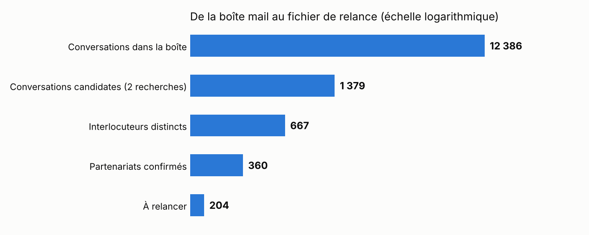
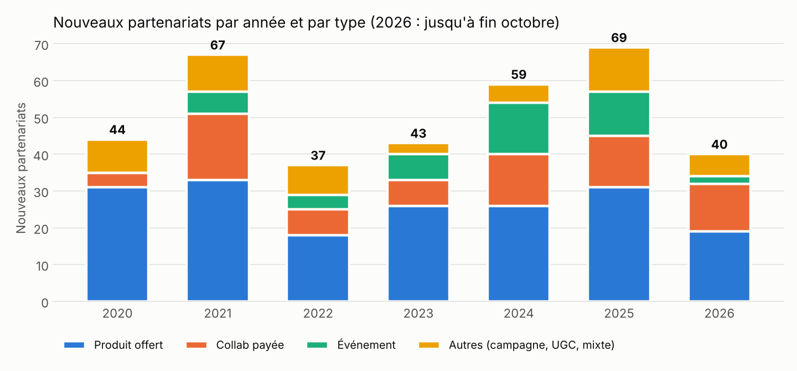
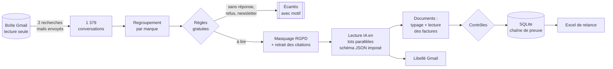

<div align="center">

# 📬 ➜ 🤝 Creator Brand Deals : Mail Recovery

### Récupérer les partenariats de marque d'une créatrice de contenu à partir de ses mails


**12 386 conversations Gmail · 6 ans d'activité ➜ 360 partenariats qualifiés, 204 relances prêtes, 183 contrats, factures et briefs classés**

</div>

---

## 🎯 En une phrase

Une créatrice de contenu lifestyle de mon entourage voulait relancer les marques avec qui elle avait déjà
travaillé. Six ans de collaborations (produits offerts, campagnes payées, événements, UGC) étaient éparpillés
dans **une boîte Gmail saturée** : aucun fichier, aucun suivi des factures, aucune idée de qui recontacter.
Ce projet a transformé cette boîte en **une base de données de sa relation commerciale**, un **fichier de
relance** prêt à l'emploi, et les **documents** (contrats, factures, briefs) rangés par marque.

> Ce dépôt est **public** mais ne contient **aucune donnée réelle** : ni mail, ni nom de marque, ni contact, ni
> montant. Seulement le code, la méthode, des comptages agrégés et une boîte 100 % fictive pour la démonstration.
> [Voir la politique de confidentialité](docs/confidentialite-rgpd.md).

---

## 📊 Le résultat

<p align="center"></p>

| Étape | Volume | Ce qui s'est passé |
|---|---:|---|
| ✉️ Conversations dans la boîte | **12 386** | Point de départ : tout l'historique, de 2019 à 2026 |
| 🔎 Conversations candidates | **1 379** | Deux recherches ciblées sur les mails **envoyés** : ‑89 % de volume sans aucun appel à l'IA |
| 🏢 Interlocuteurs distincts | **667** | Regroupement par marque ou agence : une lecture par relation, pas par mail |
| 🤝 Partenariats confirmés | **360** | Lecture par IA, une fiche au format fixe par marque ; 307 interlocuteurs écartés **avec leur motif** |
| 📞 À relancer | **204** | Collab réussie ou contact chaleureux, sans échange depuis 6 mois |
| 🏷️ Conversations libellées dans Gmail | **845** | Tout l'historique commercial retrouvable d'un clic |
| 📎 Documents extraits et classés | **183** | 53 contrats, 51 briefs, 50 factures émises, 29 autres, issus de 147 conversations |
| ⚠️ Documents à récupérer à la main | **13** | Messages de 7 à 35 Mo : listés avec le lien, au lieu de bloquer le traitement |

<p align="center"></p>

| Année | 2020 | 2021 | 2022 | 2023 | 2024 | 2025 | 2026* |
|---|---:|---:|---:|---:|---:|---:|---:|
| Nouveaux partenariats | 44 | 67 | 37 | 43 | 59 | 69 | 40 |

<sub>* 2026 jusqu'à fin octobre. Comptages uniquement, issus de [`docs/figures/agregats.json`](docs/figures/agregats.json) ; figures régénérables avec `python scripts/make_figures.py`.</sub>

**Ce que la personne accompagnée a reçu :** un classeur Excel (7 onglets : synthèse, partenariats avec relances
surlignées, factures, contrats, briefs, documents à récupérer, alertes), les documents rangés par marque, le
libellé « Partenariats » dans Gmail, et une liste d'**alertes** qu'aucun outil ne lui avait jamais donnée :
factures en attente de paiement, numéros de facture réutilisés, dates de facture incohérentes.

---

## 🛠️ Comment ça marche



| Étape | Module | Ce qui se passe |
|---|---|---|
| 1. Récolte | [`harvest.py`](src/branddeals/harvest.py) | Deux recherches Gmail paginées sur les mails **envoyés** : une vraie collab laisse toujours une réponse de la créatrice. Dédoublonnage des conversations trouvées deux fois. |
| 2. Regroupement | [`harvest.py`](src/branddeals/harvest.py) | Une clé par interlocuteur : le domaine (`marque.fr`) pour une entreprise, l'adresse complète pour un indépendant en Gmail. Les mails à soi-même sont écartés. |
| 3. Règles | [`classify.py`](src/branddeals/classify.py) + [`rules.yaml`](config/rules.yaml) | Sans IA : sollicitations restées sans réponse, refus polis, newsletters. Explicable, gratuit, modifiable sans toucher au code. |
| 4. Confidentialité | [`privacy.py`](src/branddeals/privacy.py) | Téléphones, IBAN, cartes, adresses postales et mails masqués **avant** l'appel au modèle. L'historique cité, souvent 90 % d'un long fil, est retiré. |
| 5. Lecture IA | [`classify.py`](src/branddeals/classify.py) | Une lecture par marque, en **lots lus en parallèle**. Appel d'outil forcé avec **schéma JSON** : type, statut, montant (vide s'il n'est pas confirmé), remarque de relance. Fournisseur interchangeable. |
| 6. Documents | [`documents.py`](src/branddeals/documents.py) | Seuls les messages porteurs d'un document sont téléchargés. Typage (facture, contrat, devis, brief…), lecture du numéro, du montant et de la date imprimée des factures. |
| 7. Contrôles | [`quality.py`](src/branddeals/quality.py) | Factures envoyées deux fois comptées une fois, numéro réutilisé pour deux clients, date imprimée incohérente, règle de relance appliquée de façon uniforme. |
| 8. Sorties | [`store.py`](src/branddeals/store.py) · [`schema.sql`](src/branddeals/schema.sql) · [`report.py`](src/branddeals/report.py) | Base relationnelle avec contraintes et vues métier, classeur Excel, libellé Gmail. |

📐 Architecture et dimensionnement : [docs/architecture.md](docs/architecture.md) · 🗄️ Modèle de données : [docs/modele-de-donnees.md](docs/modele-de-donnees.md) · 🧭 Choix et arbitrages : [docs/decisions.md](docs/decisions.md) · 🚧 Limites : [docs/limites-et-suite.md](docs/limites-et-suite.md)

---

## 🧠 L'IA au bon endroit

- **Les règles d'abord, le modèle ensuite.** Les cas évidents (sollicitations restées sans réponse, refus polis,
  newsletters) sont écartés par des règles gratuites et explicables ; le modèle ne lit que ce qui mérite d'être lu.
- **Une sortie contrôlée, pas du texte libre.** Le modèle remplit un schéma JSON dont les valeurs possibles sont
  les mêmes que les contraintes de la base : une réponse hors cadre est rejetée deux fois.
- **Le modèle ne décide pas de la politique commerciale.** Il dit si un contact était chaleureux ; la règle
  « à relancer » est calculée par le code, identique pour toutes les marques ([pourquoi](docs/decisions.md#5-la-règle-de-relance-est-appliquée-par-le-code)).
- **Il ne voit jamais de donnée personnelle inutile**, et il ne peut ni envoyer ni supprimer de mail : les droits
  OAuth s'arrêtent à la lecture et aux libellés.
- **Agents orchestrés sur la mission réelle.** Un agent principal a mené la récolte, puis a confié **27 lots** à
  des sous-agents de lecture travaillant en parallèle, et 4 lots à des sous-agents d'extraction des documents,
  chacun avec une consigne écrite ([`prompts/`](prompts/)). Ce dépôt en est la version industrialisée : rejouable
  en une commande, testée, sans dépendre de la vigilance de l'opérateur.

---

## 🚀 Essayer en 1 minute (boîte 100 % fictive)

```bash
git clone https://github.com/BiraneWANE/Creator-brand-deals-mail-recovery.git
cd Creator-brand-deals-mail-recovery
pip install -e ".[dev]"

branddeals demo --out demo_output       # aucune connexion, aucune clé d'API
branddeals views --db demo_output/partenariats.sqlite
```

La boîte fictive reproduit les pièges de la vraie : collabs payées avec contrat et facture, produits offerts,
prospections sans réponse, refus polis, newsletters, briefs trop lourds, logos de signature, **numéro de
facture réutilisé**. Sortie :

```json
{
  "conversations_candidates": 39,
  "interlocuteurs_examines": 26,
  "interlocuteurs_ecartes_par_regles": 17,
  "partenariats_retenus": 9,
  "a_relancer": 6,
  "documents_extraits": 6,
  "documents_a_recuperer_a_la_main": 3,
  "alertes": 4
}
```

Sur une vraie boîte (projet Google Cloud avec l'API Gmail activée, et une clé d'API de modèle) :

```bash
pip install -e ".[gmail,llm]"
branddeals run --credentials credentials.json --me creatrice@example.com --reader llm --out sortie/
```

Tests et qualité :

```bash
pytest -q                            # 20 tests, dont un de bout en bout sur la boîte fictive
ruff check src tests scripts         # qualité du code
python scripts/check_no_pii.py       # garde-fou données personnelles
git config core.hooksPath .githooks  # active le garde-fou avant chaque commit
```

---

## 🔒 Confidentialité dès la conception

| Protection | Comment |
|---|---|
| Aucune donnée dans le dépôt | `.gitignore` sur tous les formats de données (pdf, xlsx, zip, sqlite, jsonl…) |
| Double garde-fou automatique | [`check_no_pii.py`](scripts/check_no_pii.py) bloque tout commit et tout push contenant une adresse mail, un téléphone, un IBAN, un SIREN ou une clé d'API réels |
| Minimisation avant l'IA | Masquage des données personnelles et retrait de l'historique cité avant tout appel au modèle |
| Boîte protégée | Droits OAuth limités à la lecture et aux libellés : envoi et suppression impossibles côté Google |
| Publication agrégée | Seuls des comptages sont publiés ; aucun montant, aucun nom, aucune adresse |
| Données bancaires | Les RIB trouvés en pièce jointe ne sont pas conservés |

Détails : [docs/confidentialite-rgpd.md](docs/confidentialite-rgpd.md)

---

## 🗂️ Organisation du dépôt

```
├── config/rules.yaml          règles métier, modifiables sans toucher au code
├── prompts/                   consignes données aux agents IA pendant la mission réelle
├── src/branddeals/
│   ├── sources/               API Gmail (réelle) et boîte fictive (démo, tests)
│   ├── harvest.py             récolte, dédoublonnage, regroupement, lots
│   ├── privacy.py             masquage RGPD, pseudonymisation
│   ├── classify.py            règles gratuites + lecteur IA à sortie structurée
│   ├── documents.py           pièces jointes, typage, lecture des factures
│   ├── quality.py             contrôles de cohérence, règle de relance
│   ├── schema.sql · store.py  base relationnelle et vues métier
│   ├── report.py              classeur Excel livré
│   └── pipeline.py · cli.py   orchestration et ligne de commande
├── scripts/                   garde-fou données personnelles, génération des figures
├── tests/                     unitaires, lecteur IA simulé, bout en bout
└── docs/                      architecture, modèle de données, RGPD, décisions, limites, figures
```

---

## 🗺️ Suite

1. **Fusion avec la nouvelle boîte professionnelle** (migration en cours) et dédoublonnage entre les deux.
2. **Analyse exploratoire de l'activité** : saisonnalité, part payée/offerte, fidélité des marques, délais de paiement.
3. **Suivi continu** : lecture planifiée des nouveaux échanges chaque nuit, base et relances tenues à jour.

---

<div align="center">
<sub>Licence MIT · Données de démonstration 100 % fictives (domaines <code>example.com</code>)</sub>
</div>
