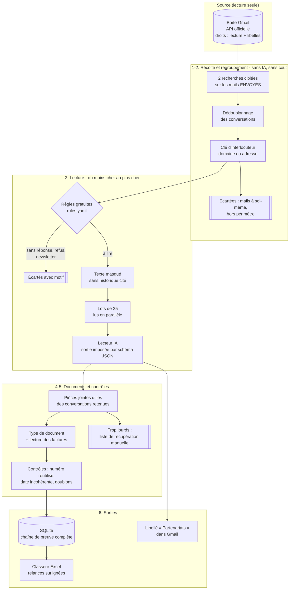

# Architecture

## Vue d'ensemble

## Modules

| Étape | Module | Rôle | Pourquoi ce choix |
|---|---|---|---|
| Source | [`sources/gmail_api.py`](../src/branddeals/sources/gmail_api.py) | Lecture via l'API Gmail, reprise automatique sur limitation de débit (attente exponentielle) | Les droits OAuth limitent le pipeline à lire et à poser des libellés : il **ne peut pas** envoyer ni supprimer, même en cas de bug |
| Source | [`sources/synthetic.py`](../src/branddeals/sources/synthetic.py) | Boîte fictive reproductible (graine fixe) avec tous les pièges rencontrés | Démo et tests sans aucune donnée réelle |
| 1-2 | [`harvest.py`](../src/branddeals/harvest.py) | Recherches paginées, dédoublonnage, regroupement par interlocuteur, découpage en lots | Ramène 12 000 conversations à ~700 interlocuteurs avant toute dépense |
| 3 | [`classify.py`](../src/branddeals/classify.py) | Règles gratuites, puis lecteur (IA ou règles) derrière une interface unique | Le fournisseur de modèle est interchangeable ; les règles traitent la moitié des cas pour zéro centime |
| 3 | [`privacy.py`](../src/branddeals/privacy.py) | Masquage (téléphone, IBAN, carte, adresse postale, mails), retrait de l'historique cité | Minimisation RGPD **et** division du volume envoyé au modèle |
| 4 | [`documents.py`](../src/branddeals/documents.py) | Filtrage des pièces jointes, typage, lecture des factures (numéro, montant, date imprimée) | Seuls les messages porteurs d'un document sont téléchargés |
| 5 | [`quality.py`](../src/branddeals/quality.py) | Doublons de factures, numéros réutilisés, dates suspectes, règle de relance uniforme | Les contrôles signalent, ils ne corrigent jamais en silence |
| 6 | [`store.py`](../src/branddeals/store.py) + [`schema.sql`](../src/branddeals/schema.sql) | Base relationnelle avec contraintes et vues métier | Chaque ligne du tableau remonte jusqu'au mail d'origine |
| 6 | [`report.py`](../src/branddeals/report.py) | Classeur Excel à 7 onglets, totaux en formules | Livrable utilisable sans aucune compétence technique |
| — | [`pipeline.py`](../src/branddeals/pipeline.py) · [`cli.py`](../src/branddeals/cli.py) | Orchestration, parallélisme, commandes `demo`, `run`, `views` | |

## Dimensionnement constaté sur la mission réelle

| Contrainte | Constat | Réponse |
|---|---|---|
| Volume | 12 386 conversations, ~12 Go | Recherches ciblées sur les mails envoyés : 1 379 conversations candidates (‑89 %) |
| Coût de lecture | Fils de 50 à 100 messages, historiques cités | Retrait des citations + regroupement : 1 lecture par interlocuteur, pas par mail |
| Temps | Lecture séquentielle estimée à plusieurs heures | 27 lots de 25 interlocuteurs lus en parallèle : ~1 h au total |
| Limite de débit Gmail | Refus ponctuels « trop d'appels par minute » | Reprise automatique avec attente croissante |
| Taille des messages | Messages de 7 à 35 Mo (vidéos, visuels) refusés par l'outil d'accès | Non bloquant : 13 documents listés avec le lien vers le mail, récupération manuelle |
| Fils géants | Un fil de 100 messages tronqué par l'API | Signalé dans la remarque du partenariat concerné |

## Comment la mission réelle a été exécutée

Sur la vraie boîte, le pipeline a été piloté par un **agent IA (Claude)** disposant d'un accès Gmail en lecture
et pose de libellés : un agent principal a fait la récolte et le regroupement, puis a confié chaque lot à un
**sous-agent** qui lisait les conversations selon la consigne de [`prompts/lecture_partenariat.md`](../prompts/lecture_partenariat.md)
et rendait des lignes JSON au format du schéma. Les réglages de la boîte (transfert, filtres, libellés) ont été
faits à l'écran avec validation humaine à chaque étape.

Ce dépôt est la **version industrialisée** de cette méthode : les mêmes étapes, rejouables en une commande,
avec une API au lieu d'un agent, des tests, et des garde-fous qui ne dépendent pas de la vigilance de l'opérateur.
