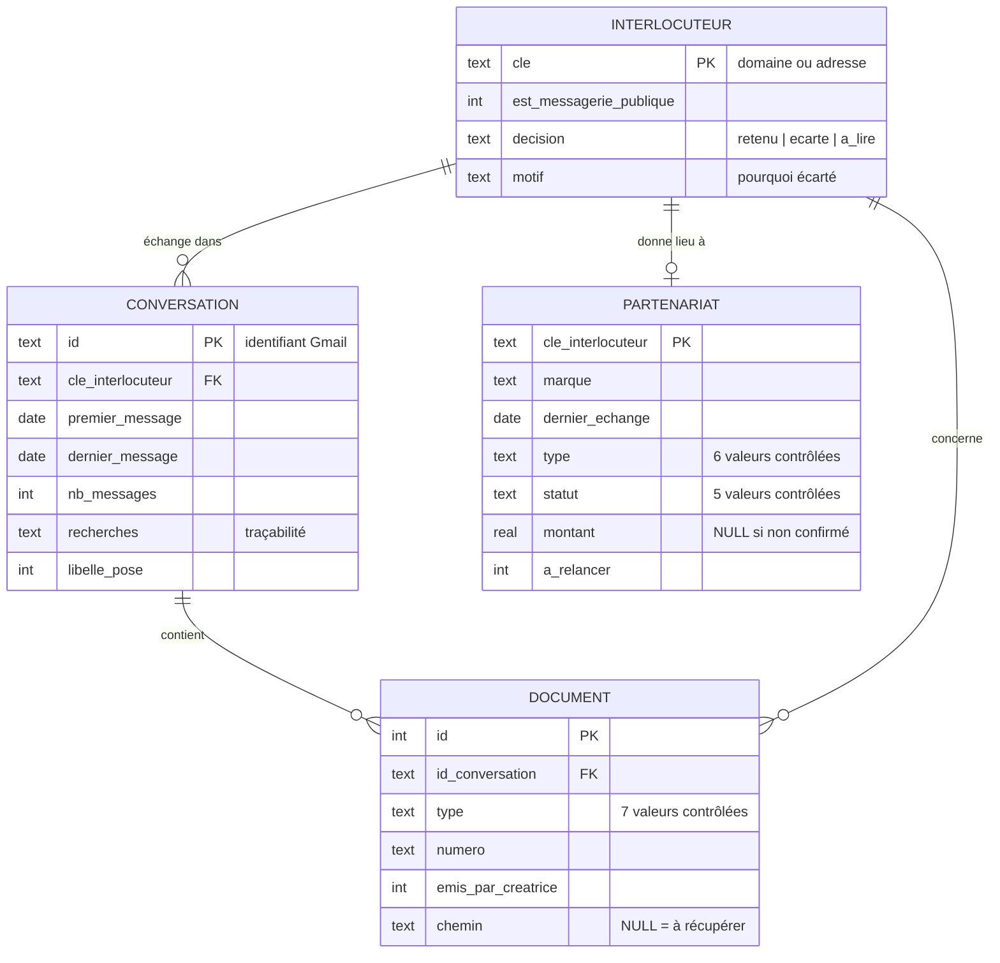

# Modèle de données

Base SQLite définie dans [`schema.sql`](../src/branddeals/schema.sql). La structure est volontairement
compatible PostgreSQL (types standards, contraintes `CHECK`, clés étrangères), pour un passage en base
serveur sans réécriture le jour où l'outil devient un CRM partagé.

## Schéma



## Choix de conception

| Choix | Raison |
|---|---|
| **Clé d'interlocuteur = domaine** (`marque.fr`), sauf messagerie grand public où c'est l'adresse | Une marque écrit depuis plusieurs personnes ; un indépendant en Gmail est une personne. Une seule règle, deux cas |
| **Un partenariat par interlocuteur** | Le besoin métier est « qui relancer » : une ligne par relation commerciale, l'historique détaillé reste dans les conversations |
| **Les écartés sont conservés** (`decision`, `motif`) | On peut auditer toute décision et rejouer les règles sans relire la boîte |
| **`montant` NULL plutôt que 0** | Un tarif proposé mais jamais confirmé n'est pas un revenu ; 0 fausserait toute somme |
| **`chemin` NULL** pour un document non téléchargé | Le document existe et on sait où le trouver : il ne doit pas disparaître des comptes |
| **Valeurs contrôlées par `CHECK`** | Les mêmes énumérations que le schéma JSON imposé au modèle : une sortie IA hors liste est rejetée à l'insertion |

## Vues métier

| Vue | Question à laquelle elle répond |
|---|---|
| `v_a_relancer` | Qui recontacter en premier ? |
| `v_factures_en_attente` | Quel argent n'est pas encore rentré ? |
| `v_numeros_factures_reutilises` | Ma numérotation de factures est-elle conforme ? |
| `v_activite_par_annee` | Comment mon activité a-t-elle évolué ? |

```bash
branddeals views --db sortie/partenariats.sqlite
```

## Dictionnaire des valeurs

**Type de collaboration** : `payée`, `produit offert`, `UGC` (contenu tourné pour la marque, publié par elle),
`campagne`, `événement`, `mixte` (rémunération + dotation).

**Statut** : `payée` (paiement confirmé par écrit), `en attente` (facture envoyée, paiement non confirmé),
`non facturée` (collab sans facture, typiquement un produit offert), `abandonnée` (échanges réels puis arrêt),
`inconnu`.

**Règle de relance** : collaboration réussie ou contact chaleureux, **et** aucun échange depuis 6 mois
(paramètre `relance.months_without_contact`). Appliquée par le code, pas laissée à l'appréciation du lecteur.
